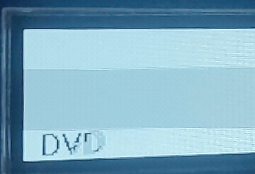

# tiepin

小さな OLED で **DVD スクリーンセーバー**（あの跳ね回るロゴ）を動かす、ネクタイピンサイズのお遊びガジェット。
"DVD" のロゴが画面を跳ね、**四隅にピタッと同時に当たった瞬間だけ**白黒が反転する ―― 俗に言う「角待ち」。



## 構成
- **MCU** … ESP32-C3 SuperMini（RISC-V）
- **表示** … SH1107 128×64 OLED（I2C・単色）
- **ライブラリ** … [U8g2](https://github.com/olikraus/u8g2)

## 配線（I2C）
| OLED | ESP32-C3 |
|:---:|:---:|
| SDA | GPIO8 |
| SCL | GPIO9 |
| VCC | 3V3 |
| GND | GND |

## ビルド / 書き込み（PlatformIO）
```sh
pio run -t upload
```

## 「角待ち」は報われるのか？
`dx=2, dy=1`・盤面 128×64 だと、横の壁は **48コマ**・縦の壁は **50コマ**ごとに当たる。
両方が同時に当たる（＝角に入る）のは **lcm(48, 50) = 1200 コマ ≒ 40秒に1度**。
`dx`/`dy` を変えれば周期も変わり、**一生角に当たらない設定**すら作れる。

## License
MIT
